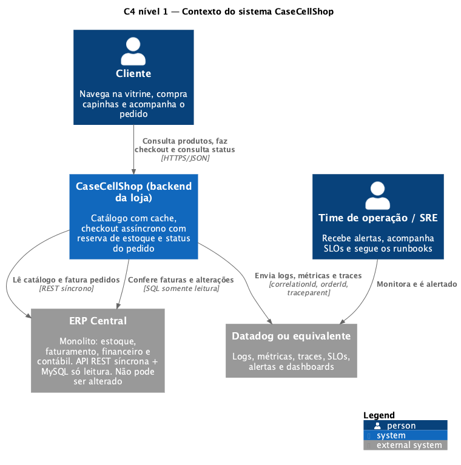
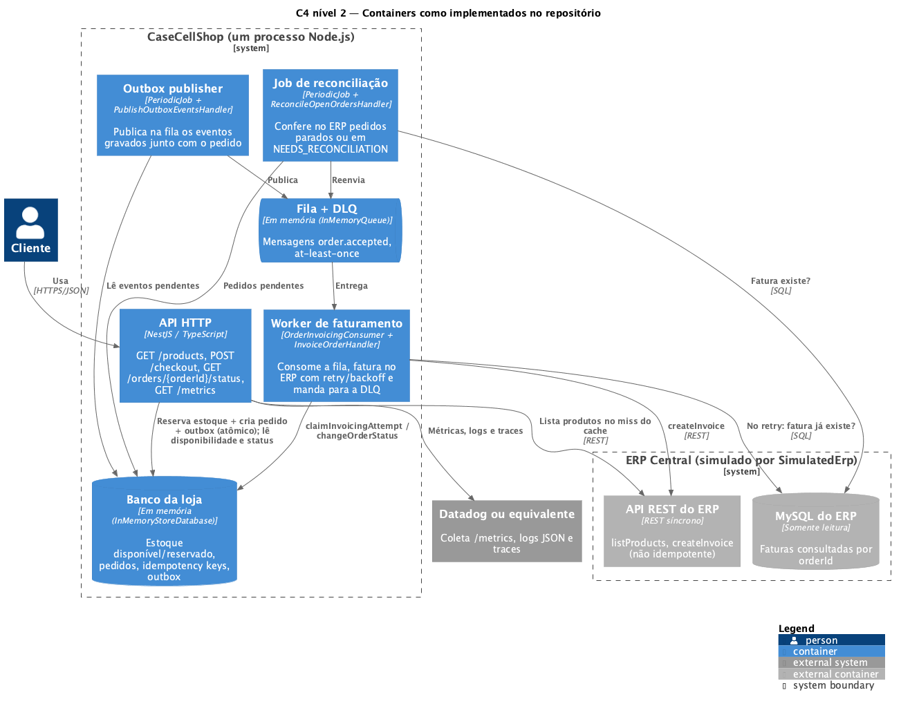
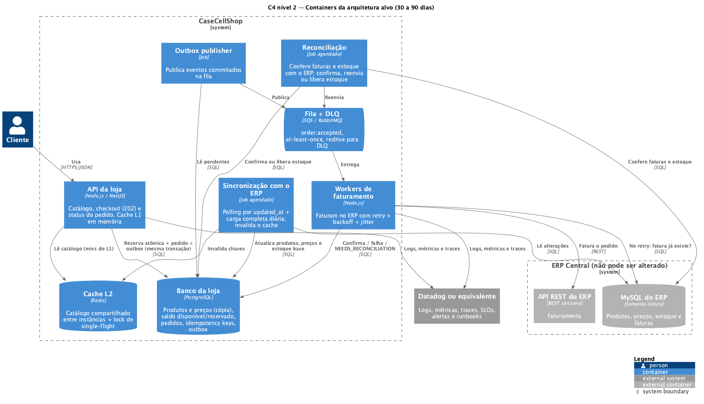
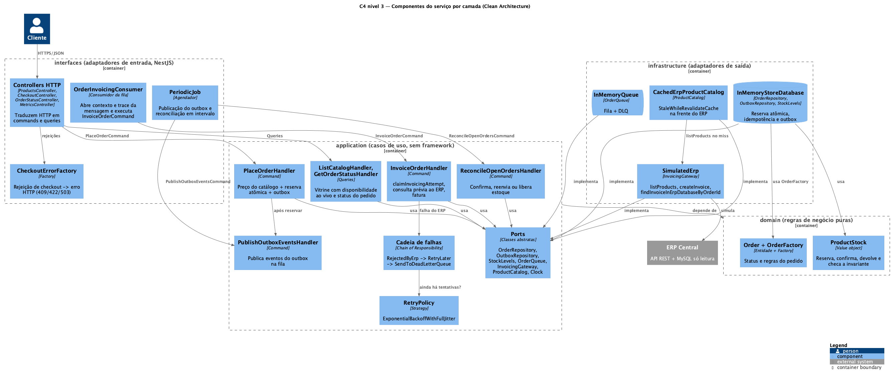
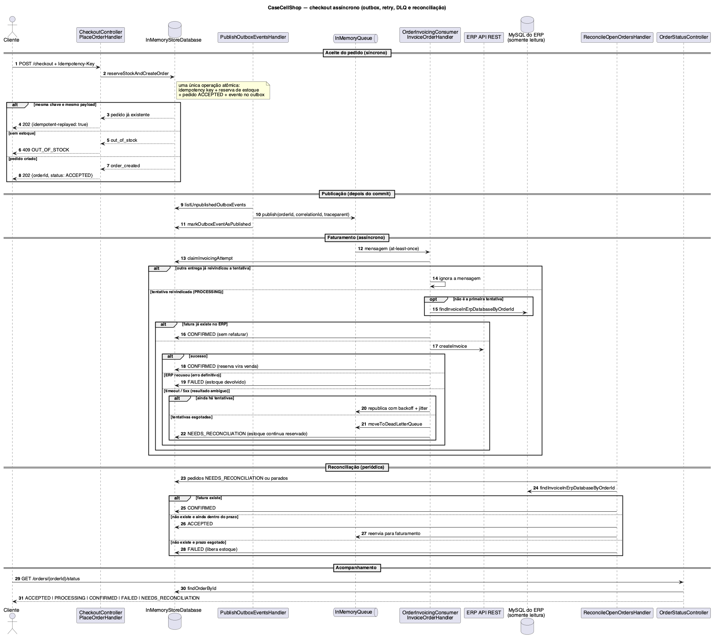

# CaseCellShop — vitrine com cache e checkout assíncrono

Esse é o mini serviço da Parte 1.B do desafio. Ele expõe o catálogo com cache, inicia um checkout assíncrono que não deixa vender além do estoque e permite acompanhar o status do pedido. Fiz em Node 20, TypeScript e NestJS.

O contrato da API está no [openapi.yaml](./openapi.yaml).

## Como rodar

```bash
npm install
npm test                 # 99 testes (unitários + integração com Jest e supertest)
npm run test:coverage    # mesmos testes com cobertura; falha se ficar abaixo de 100%
npm run typecheck
npm start           # build e sobe em http://localhost:3000
npm run start:dev   # sobe direto com ts-node, sem build
```

O ERP é simulado com 300 ms de latência. Dá pra mudar com `ERP_LATENCY_MS`.

Pra testar na mão:

```bash
curl -i localhost:3000/products                      # 1ª chamada ~300ms (X-Cache: miss), as próximas ~1ms (hit)
curl -i -XPOST localhost:3000/checkout \
  -H 'content-type: application/json' -H 'Idempotency-Key: 6f1c2d3e-aaaa-bbbb-cccc-0123456789ab' \
  -d '{"customerId":"c1","items":[{"sku":"CASE-S24-CLR","quantity":1}]}'   # 202 + Location
curl localhost:3000/orders/<orderId>/status          # ACCEPTED -> PROCESSING -> CONFIRMED
curl localhost:3000/metrics                          # métricas no formato Prometheus
```

Produtos que já sobem cadastrados:
- `CASE-IPH15-BLK`, com 50 unidades;
- `CASE-S24-CLR`, com 3 unidades, bom pra testar concorrência;
- `CASE-PX8-BLU`, sem estoque.

Também tem uma collection do Postman em `postman/CaseCellShop.postman_collection.json`. Rode no Collection Runner, na ordem, com o servidor recém iniciado, porque algumas pastas consomem o estoque. Pela linha de comando: `npx newman run postman/CaseCellShop.postman_collection.json`.

## Endpoints

São os três que o desafio pede, mais o `/metrics`:
- `GET /products`;
- `POST /checkout`, que exige o header `Idempotency-Key` e responde 202 com `orderId` e `status`;
- `GET /orders/{orderId}/status`;
- `GET /metrics`, que eu mantive porque é dele que o agente do Datadog ou do Prometheus coleta as métricas. Sem ele, as métricas não aparecem em lugar nenhum.

## Arquitetura

Desenhei os diagramas no modelo C4, com PlantUML, e eles estão em `docs/architecture/`. Também tem um diagrama de sequência do fluxo assíncrono, que é onde mora a parte mais delicada.

| Nível C4 | Diagrama | O que mostra |
|---|---|---|
| 1 — Contexto | [c4-1-contexto.puml](docs/architecture/c4-1-contexto.puml) | Loja, cliente, operação, ERP Central e Datadog |
| 2 — Containers | [c4-2-containers-implementado.puml](docs/architecture/c4-2-containers-implementado.puml) | O que roda neste repositório: um processo Node.js, com banco e fila em memória |
| 2 — Containers | [c4-2-containers-alvo-30-90-dias.puml](docs/architecture/c4-2-containers-alvo-30-90-dias.puml) | A arquitetura alvo para os próximos 30 a 90 dias |
| 3 — Componentes | [c4-3-componentes.puml](docs/architecture/c4-3-componentes.puml) | As classes do serviço e como elas se ligam |
| Sequência | [sequencia-checkout-assincrono.puml](docs/architecture/sequencia-checkout-assincrono.puml) | Checkout com outbox, retry, DLQ e reconciliação |











Pra gerar os PNGs de novo é preciso Java 11 ou mais novo. A biblioteca C4 já vem dentro do `plantuml.jar`, e o `!pragma layout smetana` dispensa o Graphviz.

```bash
for f in docs/architecture/*.puml; do java -jar plantuml.jar -pipe -tpng < "$f" > "${f%.puml}.png"; done
```

### Camadas (Clean Architecture)

O código segue a regra de dependência: cada camada só conhece as que estão mais pra dentro. O domínio não conhece ninguém, e o Nest só aparece nas bordas.

| Camada | Pasta | O que tem |
|---|---|---|
| Domínio | `src/domain` | `Order` e suas regras, `OrderFactory` e `ProductStock`. TypeScript puro, sem framework nem biblioteca |
| Aplicação | `src/application` | Os casos de uso (commands e queries com seus handlers), a política de retry e os ports, que são os contratos que os casos de uso precisam (`OrderRepository`, `OutboxRepository`, `StockLevels`, `OrderQueue`, `InvoicingGateway`, `ProductCatalog`, `Clock`) |
| Infraestrutura | `src/infrastructure` | As implementações dos ports: banco e fila em memória, ERP simulado, catálogo com cache, relógio, config e o adaptador do logger |
| Interfaces | `src/interfaces` | O que recebe o mundo de fora: controllers HTTP, DTOs, filtro de erros, middleware, o consumidor da fila e os jobs periódicos |
| Composição | `src/composition`, `src/app.module.ts` | O único lugar que sabe qual implementação vai em cada port. Pra trocar por PostgreSQL, SQS ou o ERP de verdade, é aqui que muda |
| Compartilhado | `src/shared` | Logger, métricas, tracing e contexto da requisição. Todo mundo usa, e ele não depende de nenhuma camada |

Os casos de uso:

| Tipo | Caso de uso | Quem dispara |
|---|---|---|
| Command | `PlaceOrderCommand` → `PlaceOrderHandler` | `POST /checkout` |
| Command | `InvoiceOrderCommand` → `InvoiceOrderHandler` | `OrderInvoicingConsumer`, a cada mensagem da fila |
| Command | `PublishOutboxEventsCommand` → `PublishOutboxEventsHandler` | Logo depois de um pedido novo, e o job do outbox de tempos em tempos |
| Command | `ReconcileOpenOrdersCommand` → `ReconcileOpenOrdersHandler` | Job de reconciliação |
| Query | `ListCatalogQuery` → `ListCatalogHandler` | `GET /products` |
| Query | `GetOrderStatusQuery` → `GetOrderStatusHandler` | `GET /orders/{orderId}/status` |

### Padrões de projeto (e por que cada um está lá)

- **Command:** cada ação do sistema é um objeto com os dados que ela precisa, executado por um handler. O controller não sabe como o pedido é criado, só monta o `PlaceOrderCommand`. E a mesma ação pode ser disparada por HTTP, pela fila ou por um job.
- **Chain of Responsibility:** quando o ERP falha, a falha passa por uma corrente em `invoicing-failure-chain.ts`. `RejectedByErpHandler` falha o pedido se o ERP recusou; se não, `RetryLaterHandler` agenda nova tentativa se ainda houver; se não, `SendToDeadLetterQueueHandler` manda pra DLQ. Cada regra fica numa classe pequena, e pra incluir uma nova (por exemplo, abrir circuit breaker) é só pôr mais um elo.
- **Strategy:** o cálculo de espera entre tentativas é uma `BackoffStrategy`. Hoje é `ExponentialBackoffWithFullJitter`, mas a `RetryPolicy` não sabe disso e aceita outra estratégia sem mudar nada.
- **Factory:**
  - `OrderFactory` cria o pedido já no estado certo e com o total calculado;
  - `InvoicingMessageFactory` monta a primeira mensagem e as próximas tentativas, que antes eram montadas na mão em três lugares;
  - `CheckoutErrorFactory` transforma cada rejeição em erro HTTP por uma tabela, sem `switch`. Uma rejeição nova é uma linha na tabela, e o TypeScript reclama se ela faltar.
- **Builder:** só nos testes (`CheckoutRequestBuilder` e `OrderBuilder`), onde montar dados de exemplo era repetitivo. No código de produção nenhum objeto é complexo o bastante pra pedir um builder, então não forcei.

### SOLID e object calisthenics

- Os casos de uso dependem de ports, não das classes em memória (inversão de dependência), e cada um recebe só o contrato que usa (segregação de interface). A vitrine, por exemplo, só conhece o `StockLevels`, não pedidos nem outbox.
- Cada classe tem um motivo só pra mudar. O estoque de um produto é a `ProductStock`, a política de retry é a `RetryPolicy`, cada reação a falha é um elo da corrente, e a formatação dos erros de validação tem arquivo próprio.
- Pra incluir uma rejeição de checkout ou uma reação a falha nova, eu acrescento código em vez de mexer no que já funciona (aberto/fechado).
- De object calisthenics, usei o que ajudava a leitura: métodos curtos, retorno antecipado em vez de `else`, um nível de indentação na maior parte dos métodos e o estoque como um objeto que protege as próprias regras em vez de três números soltos. Não forcei regra nenhuma onde ela só deixaria o código mais longo.

O código não tem comentários. Tentei deixar os nomes falarem por si (`reserveStockAndCreateOrder`, `claimInvoicingAttempt`, `findOrCreateInvoice`, `hasAttemptsLeftAfter`), e o porquê das decisões fica aqui no README.

### Testes e cobertura

São 99 testes, com 100% de cobertura de linhas, branches, funções e statements. O `npm run test:coverage` falha se qualquer um desses números cair.
- `test/unit`: domínio, casos de uso (com ports falsos em `test/support/fakes.ts`), adaptadores, interfaces e o compartilhado.
- `test/integration`: a aplicação inteira de pé, chamada por HTTP. Cobre cache, concorrência, idempotência, retry, DLQ, reconciliação, outbox, rastreio ponta a ponta e a ligação dos jobs.

O único arquivo fora da cobertura é o `main.ts`, que só sobe o servidor.

Cobertura alta não prova que o teste presta. Por isso também removi as proteções principais, uma de cada vez, pra ver se algum teste quebrava:
- sem a consulta ao ERP antes do retry, 6 testes falham;
- sem a checagem de tentativa no `claimInvoicingAttempt`, 1 falha;
- sem a checagem de estoque, 4 falham;
- tratando recusa do ERP como erro temporário, 2 falham.

Como o `reserveStockAndCreateOrder` ficaria num PostgreSQL de verdade, numa transação só:

```sql
INSERT INTO idempotency_keys (key, payload_fingerprint, order_id) VALUES (...);   -- UNIQUE(key)
UPDATE stock SET available = available - :qty, reserved = reserved + :qty
 WHERE sku = :sku AND available >= :qty;                                           -- 0 linhas => sem estoque, ROLLBACK
INSERT INTO orders (...) VALUES (...);
INSERT INTO outbox (event_type, order_id, payload) VALUES ('order.accepted', ...);
```

O `changeOrderStatus` seria um `UPDATE orders SET status = :novo WHERE id = :id AND status = ANY(:permitidos)`, ou seja, só muda se o pedido ainda estiver no status esperado.

## Decisões e trade-offs

1. Cache só do que pode ficar um pouco velho. Preço e nome ficam 30 segundos no cache, com jitter de 10%. A disponibilidade eu leio sempre do banco da loja, então o cache nunca mostra estoque que já acabou.
2. Pro estoque, uso update condicional atômico com o modelo de disponível e reservado. Em memória, a atomicidade vem de o trecho ser síncrono, já que o JavaScript roda numa thread só. Por isso a regra é nunca ter `await` dentro de `reserveStockAndCreateOrder` ou `changeOrderStatus`. No PostgreSQL seria o SQL acima.
3. A reserva é síncrona e o faturamento é assíncrono. O cliente sabe na hora se tem estoque (409), o 202 só sai com a reserva feita, e o ERP lento fica fora do tempo de resposta.
4. Uso outbox: o pedido e a mensagem são gravados juntos, o que evita pedido e mensagem fantasmas. O publicador roda logo depois de gravar e também de tempos em tempos.
5. A idempotência não depende do ERP, porque o case não deixa alterar ele. São três camadas:
   - o `Idempotency-Key`, com uma impressão digital do conteúdo, que devolve 422 se a mesma chave vier com outro pedido;
   - o `claimInvoicingAttempt`, que deixa só um worker faturar cada tentativa;
   - a consulta ao MySQL do ERP antes de reenviar, procurando a fatura pelo `orderId`.

   O ERP simulado não deduplica nada de propósito, pra provar que a proteção é nossa. Premissa: o `orderId` vai como referência no pedido de faturamento e dá pra ler no MySQL do ERP.
6. Falha ambígua não libera estoque. Se acabarem as tentativas, a mensagem vai pra DLQ, o pedido fica em `NEEDS_RECONCILIATION` e a reconciliação pergunta ao ERP. O estoque só volta quando a falha é certa: o ERP recusou, ou o prazo acabou sem fatura.
7. Sem preço, sem venda. Se não tem cache e o ERP está fora, a resposta é 503, nunca um preço inventado. E o dado velho só é servido por até 10 minutos.
8. O tracing é um stub que segue o modelo do OpenTelemetry, com o `traceparent` viajando dentro da mensagem da fila. Fiz assim pra não depender de agente. Pra usar o `@opentelemetry/api` de verdade, só muda o `src/shared/tracing.ts`.
9. Escolhi NestJS por ser o que a vaga usa e pelo que ele já traz: injeção de dependência, módulos, validação com `class-validator` e um filtro único de erros (`ApiErrorFilter`).

## Observabilidade

Os logs saem em JSON (pino), com `correlationId`, `traceId`, `spanId` e `orderId` preenchidos automaticamente. Com `jq 'select(.orderId=="…")'` dá pra ver tudo o que aconteceu com um pedido, inclusive dentro do worker. As métricas ficam em `/metrics`, sem labels de alta cardinalidade.

Painéis que eu montaria no Datadog ou no Grafana:
- SLO do checkout: `1 - sum(rate(http_request_duration_seconds_count{route="/checkout",status=~"5.."}[5m])) / sum(rate(http_request_duration_seconds_count{route="/checkout"}[5m]))`
- Hit ratio: `sum(rate(cache_requests_total{result=~"hit|stale"}[5m])) / sum(rate(cache_requests_total[5m]))`
- Tempo até confirmar o pedido: `histogram_quantile(0.99, sum(rate(order_confirmation_seconds_bucket[5m])) by (le))`
- Fila: `queue_oldest_message_age_seconds`, `queue_depth` e `increase(dlq_messages_total[1h])`
- Estoque: `increase(stock_reservation_rejected_total[5m])` e `oversell_invariant_violations_total`

Alertas:

| Alerta | Quando dispara | O que acontece |
|---|---|---|
| Overselling | `oversell_invariant_violations_total > 0` | Aciona alguém na hora |
| Pedidos parados | `queue_oldest_message_age_seconds > 120` por 5 min | Aciona alguém na hora |
| DLQ | `increase(dlq_messages_total[15m]) > 0` | Aciona alguém na hora |
| Error budget do checkout | consumo 14 vezes acima do normal em 5 min e em 1 h | Aciona alguém na hora |
| ERP degradado | `rate(cache_requests_total{result="stale_if_error"}[10m]) > 0` | Abre ticket |
| Cache rendendo pouco | hit ratio abaixo de 90% por 15 min | Abre ticket |

Runbook pra quando a DLQ tem mensagem ou tem pedido em `NEEDS_RECONCILIATION`:
1. Impacto: tem pedido com estoque reservado e sem fatura, e o cliente vê `NEEDS_RECONCILIATION`.
2. Diagnóstico: procurar nos logs `msg:"retries exhausted, message moved to DLQ"`, olhar o campo `err` e ver no painel como está o ERP.
3. Não liberar estoque na mão, porque o ERP pode ter faturado. A reconciliação roda a cada 30 segundos e consulta o ERP pelo `orderId`: confirma, reenvia, ou falha e libera o estoque depois de 15 minutos.
4. Quando o ERP volta, a reconciliação resolve sozinha. Pra confirmar, `reconciliation_actions_total{action="confirmed_from_erp"}` e `{action="requeued"}` devem subir e a DLQ deve esvaziar.
5. Se passar de 15 minutos, escalar pro time do ERP. Se aparecer `failed_and_released`, abrir post-mortem.

## Simplificações e limitações

- Tudo roda em memória: banco, fila e ERP. Se reiniciar, perde tudo, e não dá pra rodar mais de uma instância. Em produção eu usaria PostgreSQL pra reserva, idempotência e outbox na mesma transação, SQS ou RabbitMQ com DLQ nativa e Redis como segunda camada de cache. Os ports (`OrderRepository`, `OrderQueue`, `InvoicingGateway`, `ProductCatalog`) e o SQL acima mostram como seria essa troca: uma implementação nova de cada port e uma linha diferente em `src/composition/infrastructure.module.ts`.
- Não tem autenticação, pagamento, deploy nem ERP real, como o desafio permite. O preço cobrado no checkout é o mesmo que a vitrine mostrou, então também pode estar até 30 segundos atrasado.
- A reserva não expira, porque não existe etapa de pagamento. Com pagamento, eu colocaria um prazo na reserva e um job pra liberar as vencidas.
- Ainda existe uma pequena chance de fatura duplicada: o ERP gravar a fatura depois que o worker consultou e não achou nada. Hoje o retry começa em 500 ms e o timeout do ERP é de 2 s. Em produção eu colocaria um intervalo mínimo de retry maior que o timeout, e a reconciliação confere de novo.
- Também pode acontecer de a reconciliação desistir do pedido e o ERP faturar depois. Pra reduzir isso, o prazo de desistência (15 min) é bem maior que os timeouts, e numa próxima fase entraria a compensação, cancelando a fatura.
- As chaves de idempotência não expiram em memória. Em produção eu deixaria 24 horas.
- Ficaram de fora, mas eu faria: property-based tests, testes contra um PostgreSQL de verdade com Testcontainers, teste de carga e circuit breaker no cliente do ERP.
